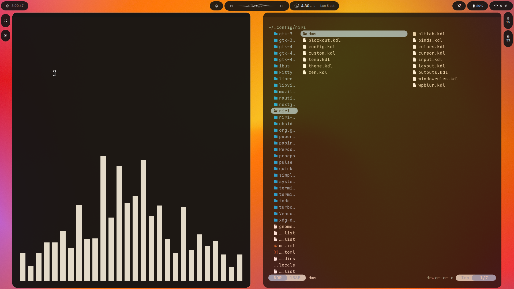
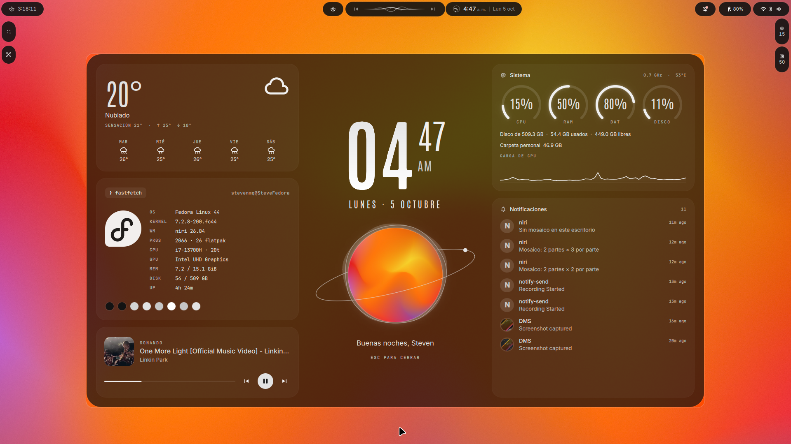
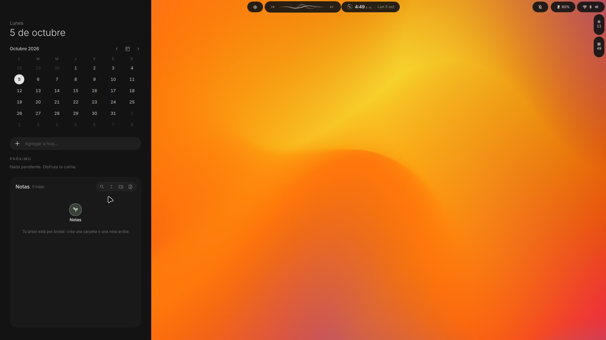
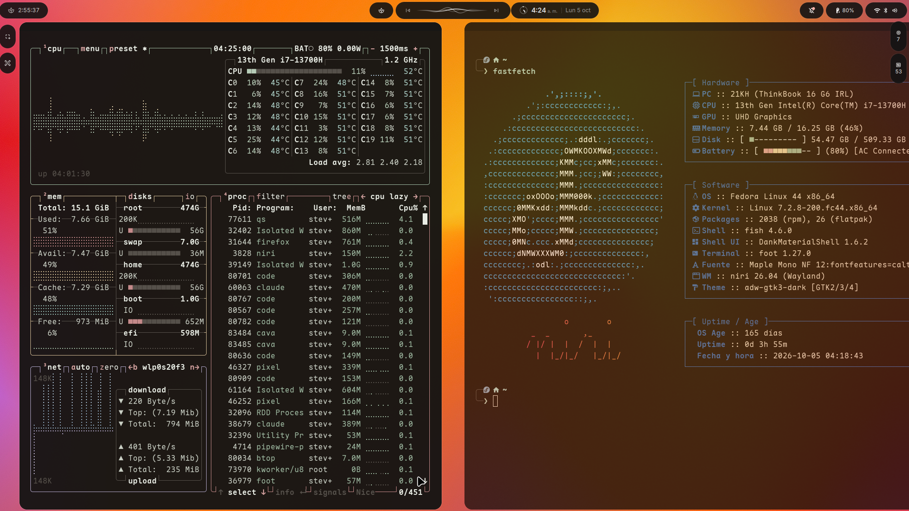

<div align="center">

# niri-dotfiles

**A Fedora workspace tuned for full-stack dev: scrolling windows, a quiet UI and everything on the keyboard.**

*Un espacio de trabajo en Fedora ajustado para desarrollo full-stack: ventanas con scroll, una interfaz tranquila y todo desde el teclado.*


[English](#english) · [Español](#español)


https://github.com/user-attachments/assets/3be93858-238f-42fd-add8-b6c4246297c6

</div>

### Screenshots · Capturas

| | |
|:---:|:---:|
|  |  |
| **Zen mode** · *Modo zen* | **Floating pills** · *Píldoras sueltas* |
|  |  |
| **Lock island** · *Isla de bloqueo* | **Zen side panel** · *Panel lateral zen* |
|  | |
| **Terminal** · *btop + fastfetch* | |

---

## English

### What is this?

My daily desktop: **Fedora 44** with the **niri** scrolling compositor and **DankMaterialShell (DMS)**, patched to look and behave the way I want. Dark, minimal, no animations — built to code for hours without distractions.

### Highlights

**Desktop**

| | |
|---|---|
| **Scrolling windows** | niri lays windows out on an endless horizontal strip. Nothing ever shrinks: editor, terminal, browser and docs each get their own column. |
| **Tabbed columns** | Stack two windows in one column (`Super+Alt+←/→`) and show them as tabs (`Super+Alt+W`). |
| **Tiling layouts** | `Super+Shift+M` splits a workspace into N columns with M windows each, kept arranged automatically. |
| **Zen mode** | Always on: monochrome palette, wider gaps, a pomodoro timer and a quiet bar. |

**Shell (DMS)**

| | |
|---|---|
| **Floating pills** | Drag any bar widget to any screen edge. Each one lives in its own small pill, remembered per monitor. `Super+W` edits them. |
| **Lock island** | Custom lock screen and dashboard, with a large profile photo and a clean password field. |
| **Zen side panel** | Calendar and notes on the left edge (`Super+Shift+S` or hover the edge). |
| **Launcher** | Full-width sheet that drops from the top edge, apps in a grid. |
| **Wallpaper carousel** | `Super+Y`. Colors follow the wallpaper (matugen). |

**Everyday**

| | |
|---|---|
| **Focus** | `Super+Enter` puts the app in fullscreen and hides every pill and the bar. |
| **Private sharing** | `Super+L` hides windows with secrets (`.env`, terminals) when screen sharing. You still see them. |
| **Music** | `musica "song or link"` plays YouTube audio in the background with synced lyrics. Play, stop and volume live in the bar's waves widget, and ▶ resumes the last song where it stopped. |
| **Updates notice** | A systemd timer checks dnf and Flatpak every 6 h and sends a notification. It never installs anything. |
| **Login popups** | Google/OAuth sign-in windows open floating. |

### Keybindings

**Apps**

| Keys | Action |
|---|---|
| `Super+Space` | App launcher |
| `Super+T` / `Super+K` | Terminal (foot) / Kitty |
| `Super+C` / `Super+Shift+C` | VS Code / VS Code new empty window |
| `Super+F` · `Super+E` | Firefox · Files |
| `Super+Alt+C` | Google Chrome |

**Windows and columns**

| Keys | Action |
|---|---|
| `Super+Q` | Close window |
| `Super+Enter` | Fullscreen, hides pills |
| `Super+Alt+F` | Maximize column |
| `Super+R` / `Super+Shift+R` | Column width 1/3, 1/2, 2/3 / window height |
| `Super+Alt+←` / `Super+Alt+→` | Move window into (or out of) the neighbor column |
| `Super+Alt+W` | Show the column as tabs |
| `Super+↑` / `Super+↓` | Switch window (or tab) inside the column |
| `Super+Shift+M` | Tiling layouts menu |
| `Super+O` / `Super+Tab` | Overview |

**Shell and system**

| Keys | Action |
|---|---|
| `Super+W` | Edit pills |
| `Super+S` | Island (dashboard) |
| `Super+Shift+S` | Zen side panel (calendar, notes) |
| `Super+Y` | Wallpaper carousel |
| `Super+V` · `Super+N` | Clipboard · Notifications |
| `Super+L` | Hide private windows while sharing |
| `Super+Shift+A` | Audio output |
| `Super+B` | System status |
| `Print` · `Ctrl+Print` · `Alt+Print` | Screenshot: region · full screen · window |

### Scripts and commands

| Command | What it does |
|---|---|
| `musica "song or link"` | YouTube audio with synced lyrics. `musica -q` stops it. |
| `dot` | Git for these dotfiles (bare repo). |
| `theme start` | Applies zen mode at login: wallpaper, do-not-disturb, night light, icons, cursor. |
| `temas-aplicar actual` | Restores the current theme if something gets out of place. |
| `niri-mosaico` | Tiling layouts daemon and menu. |
| `audio-salida` | Audio output picker (fuzzel). |
| `fedora-info` | System status notification with a random tip. |
| `avisar-actualizaciones` | Update check run by its systemd timer. |
| `zen-term` | Zen terminal with a warm "bone" palette. |

### How it works

DMS is never edited in place. On every start, `~/.local/bin/dms-run-custom` copies the installed DMS and applies the patches. Each patch is all-or-nothing: if a DMS update changes the code it targets, DMS starts without that patch and shows a notice. Nothing breaks.

```
.config/niri/                 niri config, binds, zen layout
.config/dms-pills/            floating pills (patch + QML)
.config/dms-island/           lock screen / dashboard island
.config/dms-dash/             redesigned overview tab
.config/dms-launcher/         full-width app launcher
.config/dms-sounds/           soft custom sounds
.config/DankMaterialShell/    DMS settings and own plugins (zenClock, zenTimer, zenVolume, zenWaves, zenSidebar…)
.config/quickshell/           wallpaper carousel
.config/mpv/letras.lua        synced lyrics for `musica`
.config/fish/functions/       fish helpers: dot, niri, musica
.config/systemd/user/         DMS service override, update-check timer
.local/bin/                   scripts: theme, dms-run-custom, niri-mosaico, zen-term, audio-salida…
```

### Install

These are personal dotfiles, not an installer. Read them and take what you like. They are tracked as a bare repo:

```fish
git clone --bare https://github.com/VstevenMata/niri-dotfiles.git ~/.dotfiles
alias dot 'git --git-dir=$HOME/.dotfiles --work-tree=$HOME'
dot checkout
dot config status.showUntrackedFiles no
```

Requires `niri`, `dms` (DankMaterialShell), `foot`, `fuzzel`, `matugen`, `quickshell` and `jq`. Music needs `mpv`, `yt-dlp` and `socat`. Third-party plugins (`dockerManager`, `screenCaptureToolbar`) come from `plugins.lock.json`.

---

## Español

### ¿Qué es esto?

Mi escritorio de todos los días: **Fedora 44** con el compositor **niri** (ventanas con scroll) y **DankMaterialShell (DMS)**, con parches para que se vea y funcione a mi manera. Oscuro, minimalista y sin animaciones: hecho para programar horas sin distracciones.

### Lo principal

**Escritorio**

| | |
|---|---|
| **Ventanas con scroll** | niri pone las ventanas en una tira horizontal infinita. Nada se encoge: editor, terminal, navegador y docs tienen cada uno su columna. |
| **Columnas en pestañas** | Junta dos ventanas en una columna (`Super+Alt+←/→`) y muéstralas como pestañas (`Super+Alt+W`). |
| **Mosaico** | `Super+Shift+M` divide el escritorio en N columnas con M ventanas cada una, y lo mantiene ordenado solo. |
| **Modo zen** | Siempre activo: paleta monocroma, más espacio entre ventanas, pomodoro y una barra tranquila. |

**Shell (DMS)**

| | |
|---|---|
| **Píldoras sueltas** | Arrastra cualquier widget de la barra a cualquier borde de la pantalla. Cada uno vive en su propia píldora y se recuerda por monitor. `Super+W` las edita. |
| **Isla de bloqueo** | Pantalla de bloqueo y panel propios, con foto de perfil grande y un campo de contraseña limpio. |
| **Panel lateral zen** | Calendario y notas en el borde izquierdo (`Super+Shift+S` o pasando el mouse por el borde). |
| **Lanzador** | Hoja a todo el ancho que baja desde arriba, con las apps en cuadrícula. |
| **Carrusel de fondos** | `Super+Y`. Los colores siguen al fondo (matugen). |

**Día a día**

| | |
|---|---|
| **Concentración** | `Super+Enter` pone la app en pantalla completa y oculta la barra y todas las píldoras. |
| **Compartir en privado** | `Super+L` oculta las ventanas con secretos (`.env`, terminales) al compartir pantalla. Tú las sigues viendo. |
| **Música** | `musica "canción o link"` reproduce el audio de YouTube en segundo plano con letra sincronizada. Play, stop y volumen están en las ondas de la barra, y ▶ retoma la última canción donde quedó. |
| **Aviso de actualizaciones** | Un temporizador de systemd revisa dnf y Flatpak cada 6 h y avisa con una notificación. Nunca instala nada. |
| **Ventanas de login** | Las ventanas de inicio de sesión de Google/OAuth se abren flotantes. |

### Atajos

**Apps**

| Teclas | Acción |
|---|---|
| `Super+Space` | Lanzador de apps |
| `Super+T` / `Super+K` | Terminal (foot) / Kitty |
| `Super+C` / `Super+Shift+C` | VS Code / VS Code ventana nueva vacía |
| `Super+F` · `Super+E` | Firefox · Archivos |
| `Super+Alt+C` | Google Chrome |

**Ventanas y columnas**

| Teclas | Acción |
|---|---|
| `Super+Q` | Cerrar ventana |
| `Super+Enter` | Pantalla completa, oculta píldoras |
| `Super+Alt+F` | Maximizar columna |
| `Super+R` / `Super+Shift+R` | Ancho de columna 1/3, 1/2, 2/3 / alto de ventana |
| `Super+Alt+←` / `Super+Alt+→` | Meter (o sacar) la ventana en la columna vecina |
| `Super+Alt+W` | Mostrar la columna en pestañas |
| `Super+↑` / `Super+↓` | Cambiar de ventana (o pestaña) dentro de la columna |
| `Super+Shift+M` | Menú de mosaico |
| `Super+O` / `Super+Tab` | Vista general |

**Shell y sistema**

| Teclas | Acción |
|---|---|
| `Super+W` | Editar píldoras |
| `Super+S` | Isla (panel) |
| `Super+Shift+S` | Panel lateral zen (calendario, notas) |
| `Super+Y` | Carrusel de fondos |
| `Super+V` · `Super+N` | Portapapeles · Notificaciones |
| `Super+L` | Ocultar ventanas privadas al compartir |
| `Super+Shift+A` | Salida de audio |
| `Super+B` | Estado del sistema |
| `Print` · `Ctrl+Print` · `Alt+Print` | Captura: región · pantalla completa · ventana |

### Scripts y comandos

| Comando | Qué hace |
|---|---|
| `musica "canción o link"` | Audio de YouTube con letra sincronizada. `musica -q` lo para. |
| `dot` | Git para estos dotfiles (repo bare). |
| `theme start` | Aplica el modo zen al iniciar sesión: fondo, no molestar, luz cálida, iconos, cursor. |
| `temas-aplicar actual` | Restaura el tema actual si algo se desconfigura. |
| `niri-mosaico` | Daemon y menú del mosaico. |
| `audio-salida` | Selector de salida de audio (fuzzel). |
| `fedora-info` | Notificación con el estado del sistema y un consejo al azar. |
| `avisar-actualizaciones` | Revisión de actualizaciones que corre su temporizador de systemd. |
| `zen-term` | Terminal zen con paleta cálida "hueso". |

### Cómo funciona

DMS nunca se edita directamente. En cada arranque, `~/.local/bin/dms-run-custom` copia el DMS instalado y le aplica los parches. Cada parche es todo o nada: si una actualización de DMS cambia el código que toca, DMS arranca sin ese parche y avisa. Nada se rompe.

La estructura de carpetas está en la [sección en inglés](#how-it-works).

### Instalación

Son dotfiles personales, no un instalador: léelos y toma lo que te sirva. Se manejan como repo bare:

```fish
git clone --bare https://github.com/VstevenMata/niri-dotfiles.git ~/.dotfiles
alias dot 'git --git-dir=$HOME/.dotfiles --work-tree=$HOME'
dot checkout
dot config status.showUntrackedFiles no
```

Necesita `niri`, `dms` (DankMaterialShell), `foot`, `fuzzel`, `matugen`, `quickshell` y `jq`. La música necesita `mpv`, `yt-dlp` y `socat`. Los plugins de terceros (`dockerManager`, `screenCaptureToolbar`) vienen de `plugins.lock.json`.

---

<div align="center">
<sub>Dark and quiet · Oscuro y tranquilo</sub>
</div>
