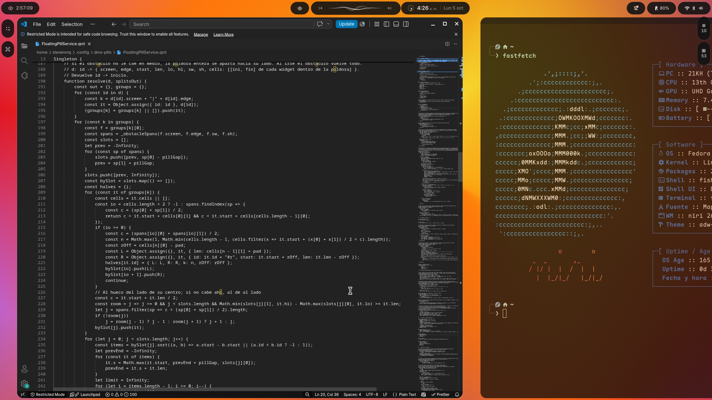
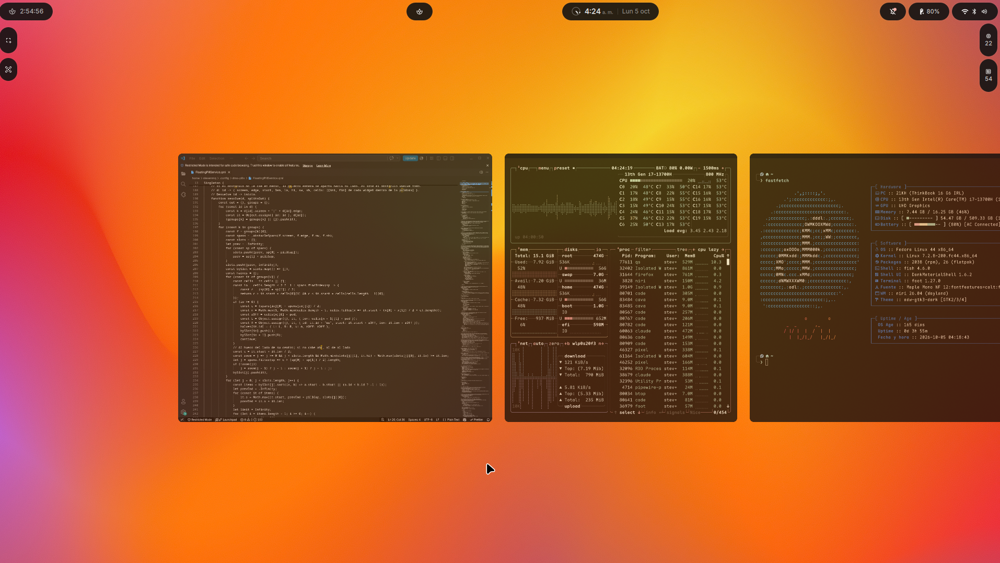

<div align="center">

# niri-dotfiles

**A Fedora workspace tuned for full-stack dev: scrolling windows, a quiet UI and everything on the keyboard.**

*Un espacio de trabajo en Fedora ajustado para desarrollo full-stack: ventanas con scroll, una interfaz tranquila y todo desde el teclado.*


[English](#english) · [Español](#español)



</div>

---

## English

### What is this?

My daily desktop: **Fedora 44** with the **niri** scrolling compositor and **DankMaterialShell (DMS)**, patched to look and behave the way I want. Dark, minimal, no animations — built to code for hours without distractions.

### Highlights

| | |
|---|---|
| **Scrolling windows** | niri lays windows out on an endless horizontal strip. Nothing ever shrinks: editor, terminal, browser and docs each get their own column. |
| **Floating pills** | Drag any bar widget to any screen edge. Each one lives in its own small pill, remembered per monitor. |
| **Zen mode** | `Super+Shift+Z` switches to a monochrome palette, wider gaps, a pomodoro timer and a quiet bar. |
| **Lock island** | Custom lock screen and dashboard, with a large profile photo and a clean password field. |
| **Focus** | `Super+Enter` puts the app in fullscreen and hides every pill and the bar. |
| **Private sharing** | `Super+L` hides windows with secrets (`.env`, terminals) when screen sharing. You still see them. |


### Keybindings

| Keys | Action |
|---|---|
| `Super+Space` | App launcher |
| `Super+T` / `Super+K` | Terminal (foot) / Kitty |
| `Super+C` · `Super+F` · `Super+E` | VS Code · Firefox · Files |
| `Super+Enter` | Fullscreen, hides pills |
| `Super+R` | Column width: 1/3, 1/2, 2/3 |
| `Super+W` | Tabbed column |
| `Super+O` / `Super+Tab` | Overview |
| `Super+S` | Island (dashboard) |
| `Super+Shift+Z` | Zen / normal mode |
| `Super+Shift+M` | Tiling layouts menu |
| `Super+Y` | Wallpaper carousel |
| `Super+L` | Hide private windows while sharing |
| `Super+Shift+A` | Audio output |
| `Super+B` | System status |
| `Super+V` · `Super+N` | Clipboard · Notifications |

### How it works

DMS is never edited in place. On every start, `~/.local/bin/dms-run-custom` copies the installed DMS and applies the patches. Each patch is all-or-nothing: if a DMS update changes the code it targets, DMS starts without that patch and shows a notice. Nothing breaks.

```
.config/niri/                 niri config, binds, zen layout
.config/dms-pills/            floating pills (patch + QML)
.config/dms-island/           lock screen / dashboard island
.config/dms-dash/             redesigned overview tab
.config/dms-sounds/           soft custom sounds
.config/DankMaterialShell/    DMS settings and own plugins (zenClock, zenTimer, zenVolume, zenWaves…)
.config/quickshell/           wallpaper carousel
.local/bin/                   scripts: theme, dms-run-custom, zen-term, audio-salida…
```

### Install

These are personal dotfiles, not an installer. Read them and take what you like. They are tracked as a bare repo:

```fish
git clone --bare https://github.com/VstevenMata/niri-dotfiles.git ~/.dotfiles
alias dot 'git --git-dir=$HOME/.dotfiles --work-tree=$HOME'
dot checkout
dot config status.showUntrackedFiles no
```

Requires `niri`, `dms` (DankMaterialShell), `foot`, `fuzzel` and `matugen`. Third-party plugins (`dockerManager`, `screenCaptureToolbar`) come from `plugins.lock.json`.

---

## Español

### ¿Qué es esto?

Mi escritorio de todos los días: **Fedora 44** con el compositor **niri** (ventanas con scroll) y **DankMaterialShell (DMS)**, con parches para que se vea y funcione a mi manera. Oscuro, minimalista y sin animaciones: hecho para programar horas sin distracciones.

### Lo principal

| | |
|---|---|
| **Ventanas con scroll** | niri pone las ventanas en una tira horizontal infinita. Nada se encoge: editor, terminal, navegador y docs tienen cada uno su columna. |
| **Píldoras sueltas** | Arrastra cualquier widget de la barra a cualquier borde de la pantalla. Cada uno vive en su propia píldora y se recuerda por monitor. |
| **Modo zen** | `Super+Shift+Z` cambia a paleta monocroma, más espacio entre ventanas, pomodoro y una barra tranquila. |
| **Isla de bloqueo** | Pantalla de bloqueo y panel propios, con foto de perfil grande y un campo de contraseña limpio. |
| **Concentración** | `Super+Enter` pone la app en pantalla completa y oculta la barra y todas las píldoras. |
| **Compartir en privado** | `Super+L` oculta las ventanas con secretos (`.env`, terminales) al compartir pantalla. Tú las sigues viendo. |



### Atajos

La tabla de atajos de arriba aplica igual. Los más usados:

| Teclas | Acción |
|---|---|
| `Super+Space` | Lanzador de apps |
| `Super+Enter` | Pantalla completa, oculta píldoras |
| `Super+R` | Ancho de columna: 1/3, 1/2, 2/3 |
| `Super+S` | Isla (panel) |
| `Super+Shift+Z` | Modo zen / normal |
| `Super+L` | Ocultar ventanas privadas al compartir |
| `Super+Y` | Carrusel de fondos |

### Cómo funciona

DMS nunca se edita directamente. En cada arranque, `~/.local/bin/dms-run-custom` copia el DMS instalado y le aplica los parches. Cada parche es todo o nada: si una actualización de DMS cambia el código que toca, DMS arranca sin ese parche y avisa. Nada se rompe.


### Instalación

Son dotfiles personales, no un instalador: léelos y toma lo que te sirva. Los pasos (repo bare con el alias `dot`) están en la sección en inglés.

---

<div align="center">
<sub>Dark and quiet · Oscuro y tranquilo</sub>
</div>
